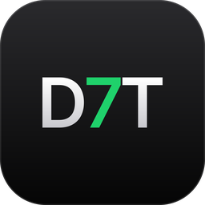

# D7my-TV

<p align="center">
  
</p>

**A free, open-source IPTV player for Windows with a built-in MPV engine.**
Bring your M3U playlists, Xtream Codes account or Stalker portal to watch live
TV, browse movies and series, and pick up where you left off.

[Releases](https://github.com/byd7my/d7my-tv/releases) ·
[Issues](https://github.com/byd7my/d7my-tv/issues) ·
[Gallery](docs/screenshots.md)

> [!IMPORTANT]
> D7my-TV is a **player**: it does not provide or sell subscriptions, channels,
> playlists or other media. Download only from
> [GitHub Releases](https://github.com/byd7my/d7my-tv/releases).

D7my-TV is based on [IPTVnator](https://github.com/4gray/iptvnator) (MIT
licensed) and is an independent project.

## Download

Get the latest build from
[GitHub Releases](https://github.com/byd7my/d7my-tv/releases). For other
install options and nightly builds, see [Installation](docs/installation.md).

## Features

- **Your sources together:** local or remote M3U/M3U8 playlists, Xtream Codes,
  and Stalker / Ministra portals.
- **Live TV:** channel groups, search and favorites; XMLTV guide, multi-channel
  EPG and catch-up on desktop.
- **Movies and series:** posters, seasons, watch history and resume positions;
  optional TMDB metadata with your own API key.
- **Playback options:** the built-in MPV engine with live stream info and audio sync
  controls on desktop.
- **Watch later:** desktop downloads for movies and episodes, plus
  continue-watching and favorites across sources.
- **Make it yours:** light and dark themes, 21 language options, keyboard
  shortcuts and a command palette (`Ctrl/Cmd+K`).
- **Use your screen:** desktop apps, a self-hosted PWA and a phone remote for
  the desktop player.

[Full feature list and platform limits](docs/features.md) ·
[Keyboard shortcuts](docs/keyboard-shortcuts.md) ·
[All screenshots](docs/screenshots.md)

## Self-hosted PWA

Run the browser app and its backend together with Docker:

```bash
docker compose -f docker/docker-compose.yml up --build -d
```

Open <http://localhost:4333>. No separate backend container is needed.
Connected clients can share source definitions. Favorites and watch progress
have separate synchronization opt-ins; history stays local to each device.

The PWA does not include M3U XMLTV, Embedded MPV, managed external-player
launching, the download manager or Electron remote-control features.
See [Docker setup and client connections](docker/README.md) for configuration,
reverse proxies, playback troubleshooting and platform limits.

## Smart TV

### LG webOS and Samsung Tizen

LG webOS and Samsung Tizen share a dedicated, experimental TV client for M3U,
Xtream Codes and Stalker / Ministra sources. It requires a compatible D7my-TV
web backend. Build and install the package for your TV in Developer Mode.

- [LG webOS installation](apps/tv/README.md#installation)
- [Samsung Tizen installation and signing](apps/tv/tizen/README.md)

Add sources from your phone by scanning a QR code, or connect the TV to your
self-hosted D7my-TV source library. Favorites, history and resume positions
currently stay on the TV.

See the [TV README](apps/tv/README.md) for compatibility, phone setup, source
synchronization and screenshots.

### Fire TV / Android TV shell (experimental)

The Android shell bundles the same PWA used in the browser with an embedded
backend. It's designed primarily for Fire TV Stick and Android TV devices with a
D-pad remote. You can try it on tablets. Compact phone screens still need layout
work.

The `Build TV shell APK` workflow can publish a GitHub release, marked as a
pre-release by default. For APK builds, installation and remote controls, see
the [Android shell guide](./tv-shell/README.md).

## Help and development

- [Troubleshooting](docs/troubleshooting.md) — startup fixes.
- [Build and develop](docs/development/README.md) — Node/pnpm setup, local
  Electron/PWA runs and diagnostics.
- [Developer and agent documentation](docs/maintenance/agent-context-map.md) —
  subsystem contracts; [AGENTS.md](AGENTS.md) and the
  [agent workflow](docs/development/agent-workflow.md) cover contribution rules.
- [Report a bug](https://github.com/byd7my/d7my-tv/issues).

## License

The source code is [MIT licensed](LICENSE.md). Copyright notices of the
original IPTVnator project are kept as the license requires. The IPTVnator name
and logo belong to their owner; see [TRADEMARK.md](TRADEMARK.md).
