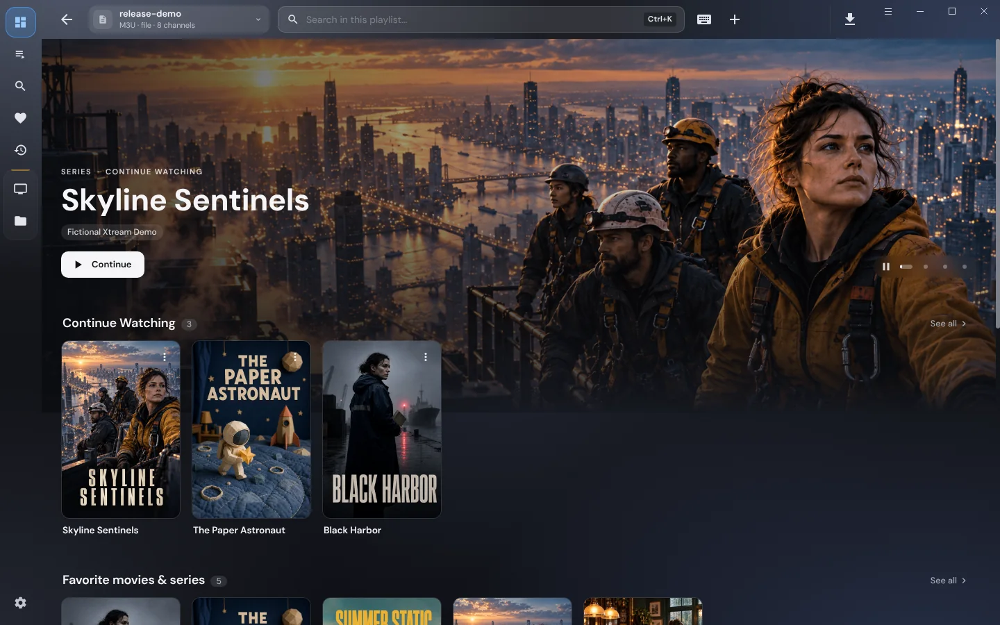
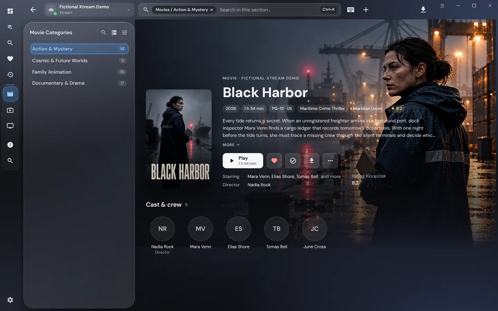
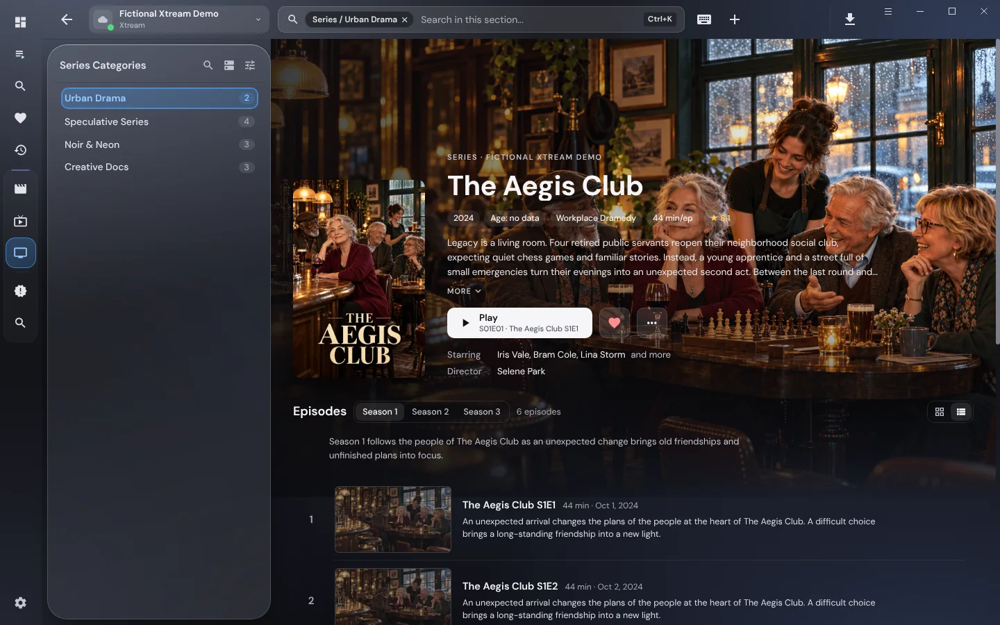
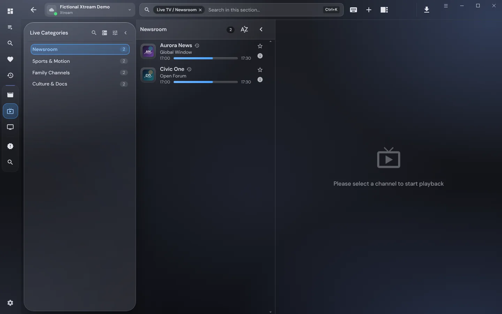
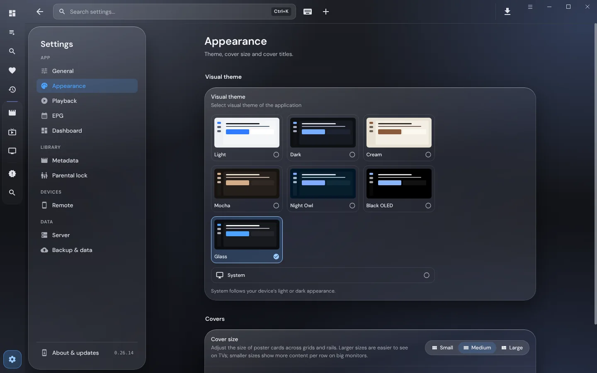
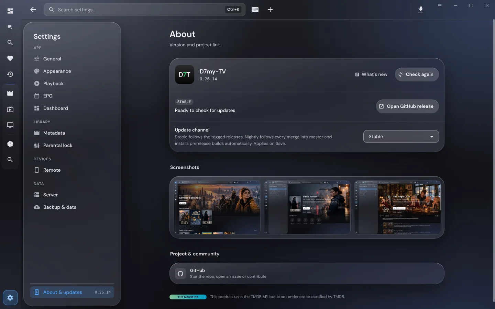

# Screenshot gallery

[Back to README](../README.md)

D7my-TV is a player and does not supply channels or media. The images show
demonstration content only, in the Glass theme (Settings → Appearance).

[Full feature list](features.md)

## Dashboard

## Movies

## Series and episodes

## Live TV

## Themes

## About

